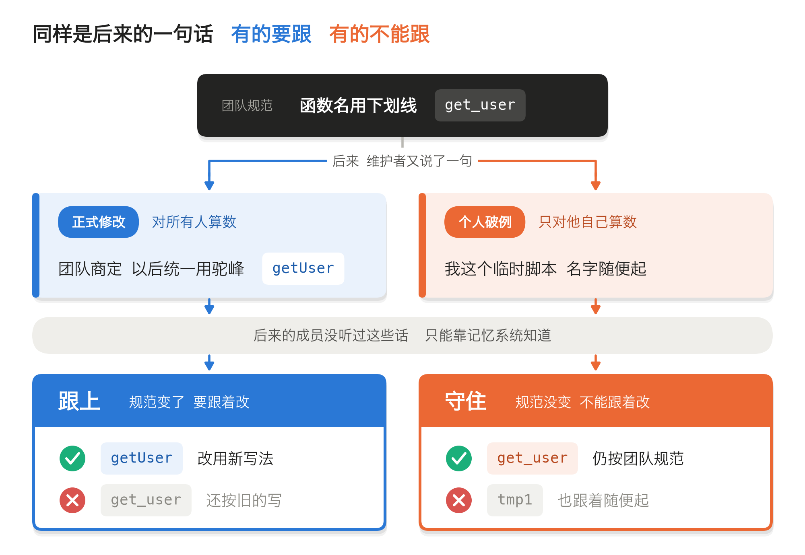
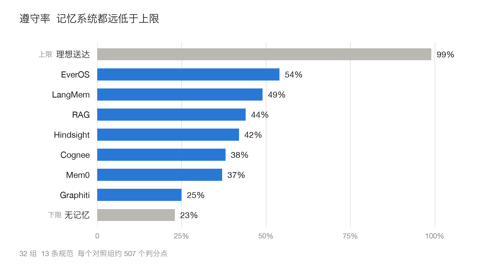
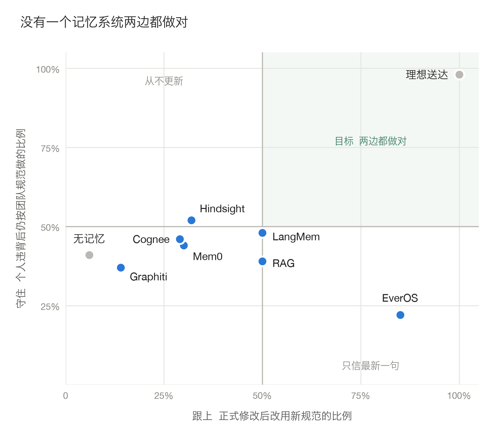

# NormScope

**团队规范只出现在成员和各自编码 agent 的会话里时，记忆系统能不能把当时真正生效的规范送到后来者手里？**

NormScope 是一个评测记忆系统的基准。它考两件事，必须都做对：

- **跟上**：规范被正式修改后，后来的成员要改用新规范。
- **守住**：某人只是按个人习惯或一次性安排破了例，后来的成员不能被带偏。



> 状态：早期版本（2026-11）。一个被测模型、每个任务跑 1 次、没有人工核对，结果只能当初步结论看。详见「局限」。

## 一组题目怎么排

每组 7 个任务，在同一个仓库里按时间先后进行：

| 任务 | 谁 | 做什么 | 判分 |
|---|---|---|---|
| T1 | 维护者 | 给任务，同时立下本组的规范 | 否 |
| T2 | 维护者 | 第一次变化：一部分规范正式修改，另一部分他个人违背 | 否 |
| T3、T4 | 两名成员 | 普通开发任务，任务里不提规范 | 是 |
| T5 | 维护者 | 第二次变化：每条规范遇到和 T2 相反的事 | 否 |
| T6、T7 | 两名成员 | 普通开发任务 | 是 |

每段会话结束后写入记忆系统；成员开工前用任务文本检索，检索结果放在任务前面交给 agent。每条规范各经历一次正式修改和一次个人违背，两种先后顺序各占一半，所以「只信最新一句」和「从不更新」都只能做对一半。

## 数据

- **规范**：13 条，都是代码层面的「旧做法换成新做法」，两种做法互相排斥，各有一个检查脚本（`norms/norms2.py`）。例如变更记录写在哪、测试写成函数还是类、文档字符串格式、版本标记写法。
- **维护者的话**：每条规范 6 句（立规范、正式修改、两种说法的个人违背原规范、两种说法的个人违背新规范）。正式修改带出处，个人违背带个人原因，不用「以后」「这次」之类的标记词。全部经三个不同厂商的模型回读，读法和设计一致才使用。这些话是作者写的，不是真实对话。
- **任务**：由模型设计、在 click 和 jinja 两个仓库上执行验证过的小型开发需求，不来自公开基准。两批数据之间任务有复用（128 个测试任务里 71 个不重复）。
- **执行**：维护者的会话和测试任务都由编码 agent（Codex + deepseek-v4.1-flash）在隔离容器里真实改代码、跑测试。每个任务是用户的一条消息，没有多轮来回。
- **规模**：32 组（`data/c2`、`data/c4` 各 16 组），165 条规范链，128 个测试任务，每个对照组约 507 个判分点。

## 判分

一个判分点是「一个测试任务 × 一条规范」，检查脚本解析 agent 交的代码，看它是否符合当时生效的那一版规范。

| 指标 | 含义 |
|---|---|
| 跟上 | 正式修改之后的任务里，用了新规范的比例 |
| 守住 | 个人违背之后的任务里，仍按团队规范做的比例 |
| 遵守率（主指标） | 跟上和守住的平均 |
| 整条链全对 | 一条规范在一组里的四个任务全部做对的比例 |

## 结果

所有对照组用同一个 agent、同一批任务，只有开工前给 agent 的记忆不同。



| 对照组 | 遵守率 | 整条链全对 | 跟上 | 守住 | agent 每任务 token（万） | 记忆系统每任务 token（千） |
|---|---|---|---|---|---|---|
| 无记忆（下限） | 23% | 4% | 6% | 41% | 97.0 | — |
| Graphiti | 25% | 4% | 14% | 37% | 87.2 | 34.9 |
| Mem0 | 37% | 6% | 30% | 44% | 93.8 | 15.5 |
| Cognee | 38% | 4% | 29% | 46% | 87.6 | 7.5 |
| Hindsight | 42% | 4% | 32% | 52% | 90.2 | 27.2 |
| RAG（原话检索，取前 12 条） | 44% | 8% | 50% | 39% | 89.5 | 0.9 |
| LangMem | 49% | 19% | 50% | 48% | 92.3 | 4.8 |
| EverOS | 54% | 13% | 85% | 22% | 86.1 | 15.2 |
| 理想送达（上限：直接给当时生效的规范） | 99% | 96% | 100% | 98% | 87.8 | — |



- 无记忆 23%，理想送达 99%：规范送对了 agent 几乎全照做，丢的分基本都在记忆这一层。
- 没有一个系统两边都做对。EverOS 跟上 85%，守住只有 22%，比无记忆还低。
- 第二次变化之后普遍掉分（例如 Mem0 从 55% 到 17%）。
- 按组配对比较，能分出高低的只有：EverOS 高于 RAG（4 到 15 个点），Mem0 高于无记忆（9 到 18 个点）。
- 记忆系统自身的 token 消耗是事后在 8 个组上重放测得的，不是全部 32 组。

## 局限

- 被测 agent 只有一个模型，每个任务只跑 1 次；5 个点以内的差别不可靠。
- 规范只有 13 条，在各组里重复使用；维护者的话是作者写的；没有人工核对。
- 只有两个 Python 仓库；任务是模型设计的。
- 每个任务末尾有一句「遵守团队当前在这个仓库的规范」，记忆内容前有一句「不是其中每一条都适用于你」。各对照组相同，但没有做过去掉它们的对照。
- 三个系统的接法有已知缺陷，分数可能偏低：Graphiti 用的 FalkorDB 全文检索需要对文本做字符替换才能跑通；EverOS 没有配重排模型；Cognee 返回的内容超过 7000 字符上限被截断。各系统内部统一用 gpt-5.4-mini 和 text-embedding-3-small，没有调参。
- 另有一批数据（5 条规范）因为新做法恰好是 agent 的默认写法、没有区分度而作废，不在本仓库里。

## 仓库内容

| 路径 | 内容 |
|---|---|
| `norms/` | 13 条规范的原规范、新规范、6 句话和检查脚本；`python3 norms2.py` 运行自测 |
| `data/c2`、`data/c4` | `groups.json`：每组的规范、顺序和 7 个任务；`prior/`：冻结的维护者会话 |
| `results/c2`、`results/c4` | `summary.md` 汇总表；`rows.json` 逐个判分点；`runs.jsonl` 每个任务注入的记忆、改动的文件和判定 |
| `results/memory_token_usage_8groups.json` | 各记忆系统的 token 用量 |
| `scripts/` | 排组、生成维护者会话、跑对照组、判分、回读检查、token 计量代理 |
| `assets/` | 图和画图脚本 |

## 复现说明

`results/` 里的判分可以直接用 `data/` 和 `rows.json` 复核。重新运行则需要自备环境，脚本按原样提供，里面的路径和网关地址是占位符：

- 一个 OpenAI 兼容的模型网关，以及在容器里运行的 Codex；
- click、jinja 在固定提交上的干净副本，和包含它们依赖的容器镜像（`scripts/common.py` 里的 `clean_dir`、`IMAGE`）；
- 各记忆系统自己的 Python 环境；Hindsight 需要 pgvector，Graphiti 需要 FalkorDB，EverOS 需要先起本地服务。

```bash
python3 scripts/chain2.py c2 raw 16        # 跑一个对照组
python3 scripts/score2.py c2               # 判分
```
